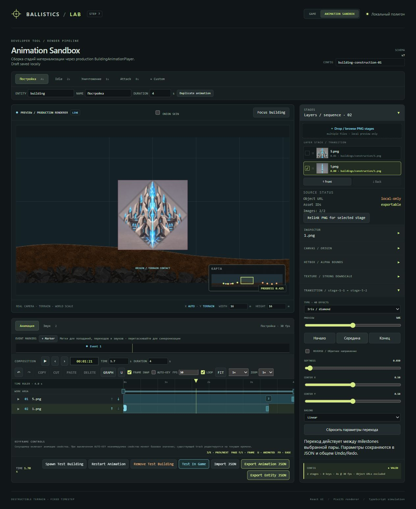

# Переходы стадий — schema v7

Добавлены 37 эффектов к исходным Crossfade, Reveal и Dissolve: всего 40.
Каталог не претендует на все существующие плагины и алгоритмы переходов; это реализованный
практический набор для PNG-стадий одной сущности, доступный в sandbox и production player.

| Группа          | Переходы                                                                                                                                                            |
| --------------- | ------------------------------------------------------------------------------------------------------------------------------------------------------------------- |
| Смешивание · 4  | Cut, Crossfade, Fade through color, Flash                                                                                                                           |
| Маски · 13      | Reveal, Linear wipe, Radial wipe / double fan, Clock wipe, Iris circle/box/diamond, Blinds horizontal/vertical, Checkerboard, Diagonal stripes, Barn door, Scanline |
| Растворение · 7 | Gradient wipe, Noise dissolve, Random blocks, Pixel dissolve, Luma dissolve, Ink spread, Burn                                                                       |
| Движение · 9    | Slide, Push, Zoom in/out, Rotate, Flip horizontal/vertical, Stretch, Bounce                                                                                         |
| Искажения · 7   | Blur, Pixelate, Glitch, Wave, Ripple, Swirl, RGB split                                                                                                              |

Контекстные параметры: 11 направлений, reverse, угол, центр X/Y, softness, strength,
segments/density, noise scale, direction strength, seed, цвет/ширина/интенсивность края,
edge blend и easing. Переход движется между milestones соседних стадий; ползунок PREVIEW
и кнопки начала/середины/конца перемещают общий курсор. Изменения входят в общий Undo/Redo,
IndexedDB-черновик и экспорт библиотеки сущности. Сброс не меняет IDs пары стадий.

Все эффекты вычисляются из progress: нет привязки к wall-clock или накопления трансформаций.
Рисунок процедурных масок повторяется при seek с одинаковым seed в текущем GPU renderer.
Keyed opacity сохраняется, движение компонуется вокруг выбранной точки canvas,
фильтры двух стадий имеют отдельные uniform-группы. Shader учитывает фактический frame
render texture, использует highp precision и сохраняет premultiplied alpha.
Цветовые переходы окрашивают силуэт, не игровой экран. Hitbox, звук и simulation не изменены.

Миграция v2–v6 добавляет новые поля и сохраняет библиотеку, markers и audio clips.
Legacy Reveal получает left-to-right: так работал прежний player независимо от direction.
Маски теперь проявляют пиксели с исходной opacity, без дополнительного умножения на Crossfade.

Проверка 01.10.2026:

- Typecheck, ESLint, production build и `format:check` прошли.
- 43 теста редактора и production player прошли: все ID/направления проходят JSON round-trip,
  проверены миграция, границы параметров, easing, endpoints, reverse, keyed opacity,
  композиция transforms вокруг центра и повторный seek без остаточных фильтров.
- Полный `npm run test`: 307 тестов, 302 прошли, 5 прежних ошибок в AppSettings,
  ricochetIntegration и terrainSettling. Те же ошибки были зафиксированы до расширения переходов
  в `AnimationEditor_v6.md`; эти модули в данной задаче не менялись.
- В локальном браузере выбран каждый из 40 эффектов на двух PNG-стадиях; проверены
  controls, начало/середина/конец и возврат к preview. После исправления GLSL precision
  новых предупреждений/ошибок WebGL нет. Native UI smoke не заменяет пиксельное сравнение
  каждого эффекта; shader компилируется целиком, unit-tests отдельно проверяют sampling.

